# Exhibit

Exhibit 是一个终端智能体：用 Python（AgentScope 2.x）做推理与真实工具调用，用
React-Ink 渲染终端界面，两者通过 stdio 上的 JSON 行协议通信。

## 能力

| 功能 | 说明 |
| --- | --- |
| 常驻聊天 | 多轮上下文、流式回复、普通问答与文件编写 |
| 计划模式 | `/plan` 只读分析；不注册写工具 |
| 会话分叉 | `/fork` 复制历史、模式和文件记录 |
| 四类审查 | `/init`、`/review arch\|audit\|repo\|git`、`/diff` |

## 界面一览

以下截图全部来自真实终端会话（Windows ConPTY，112 列），目标是
`med-ins` 这个 Spring Boot 医保结算仓库。

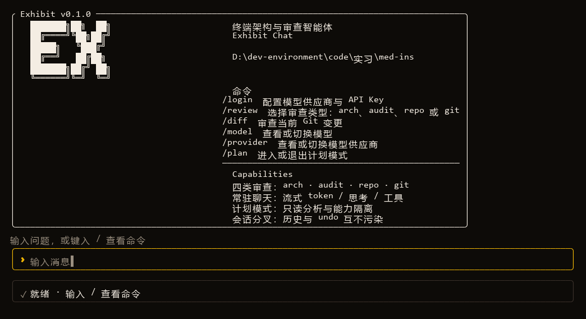

| 命令面板：输入 `/` 立即列出命令与一行说明 | 会话状态：`/status` 显示会话、模式、供应商与模型 |
| --- | --- |
| 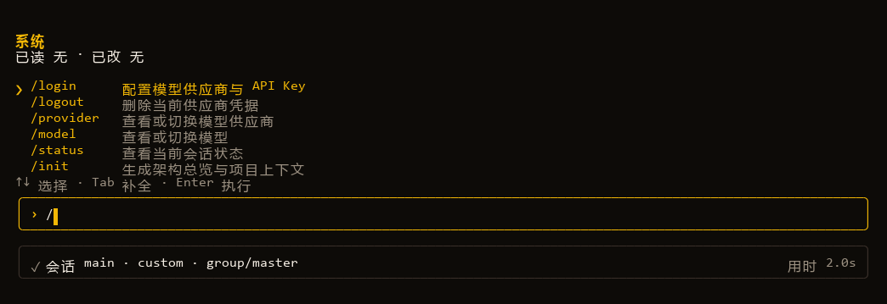 | 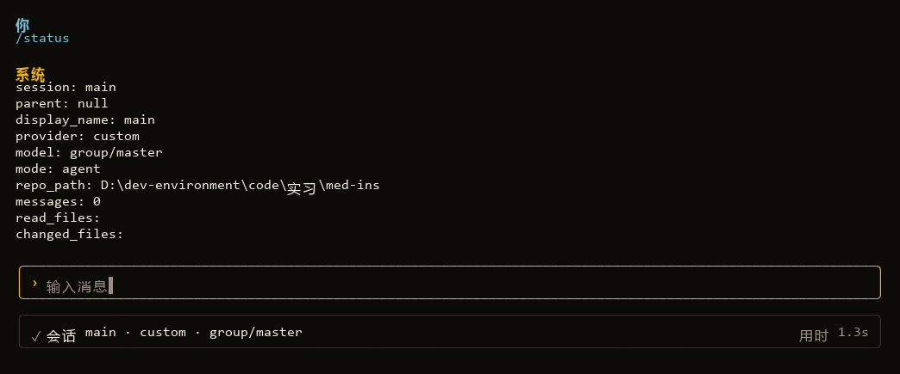 |
| **供应商**：`/provider` 列出各供应商的登录状态 | **模型选择**：`/model` 实时拉取目录并标出当前模型 |
| 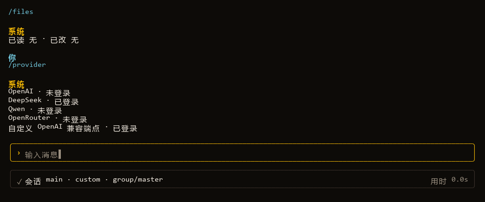 | 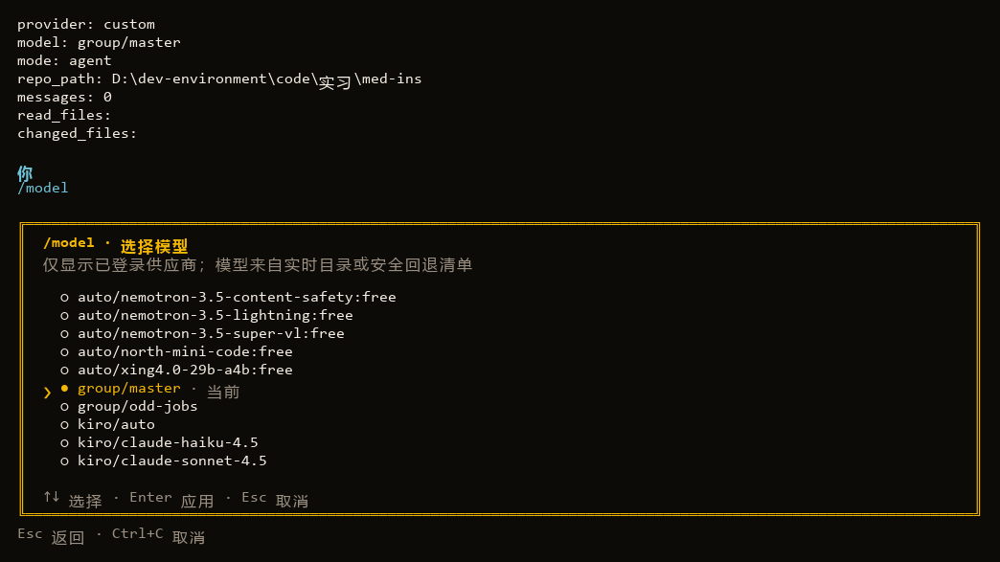 |
| **登录**：`/login` 选供应商，Key 掩码输入 | **计划模式**：`/plan` 只读分析，输入框与横幅同时提示 |
| 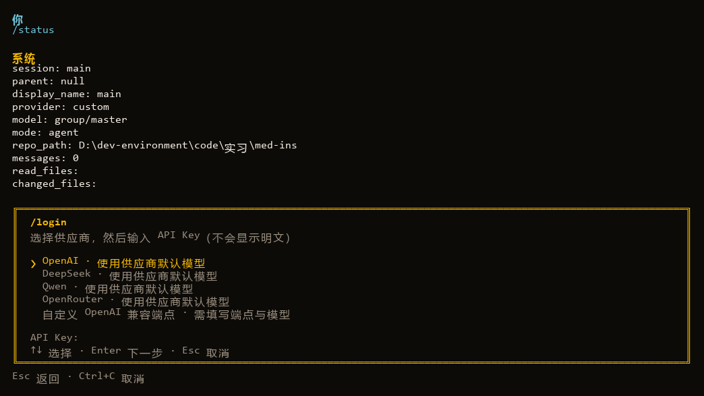 | 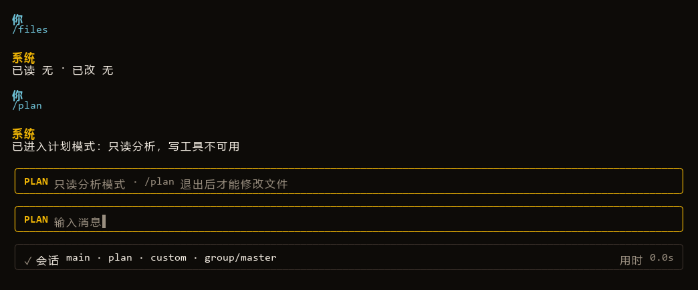 |

**常驻聊天**：流式回复 + 折叠的运行轨迹（思考步数、工具次数，`Ctrl+T` 展开）

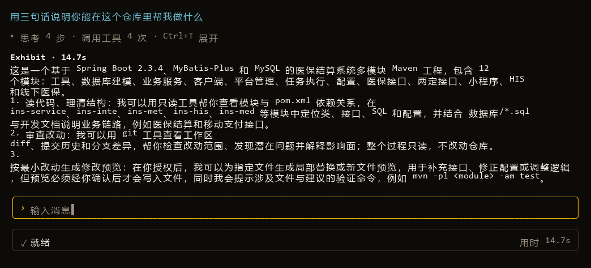

**写入确认**：所有修改先生成预览，按 `y` 允许一次、`s` 本会话允许、`n` 拒绝

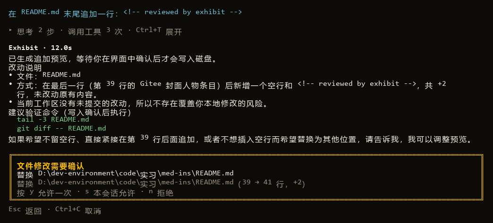

**审查报告**：报告直接进入聊天流，中文分级并标注 `文件:行号`

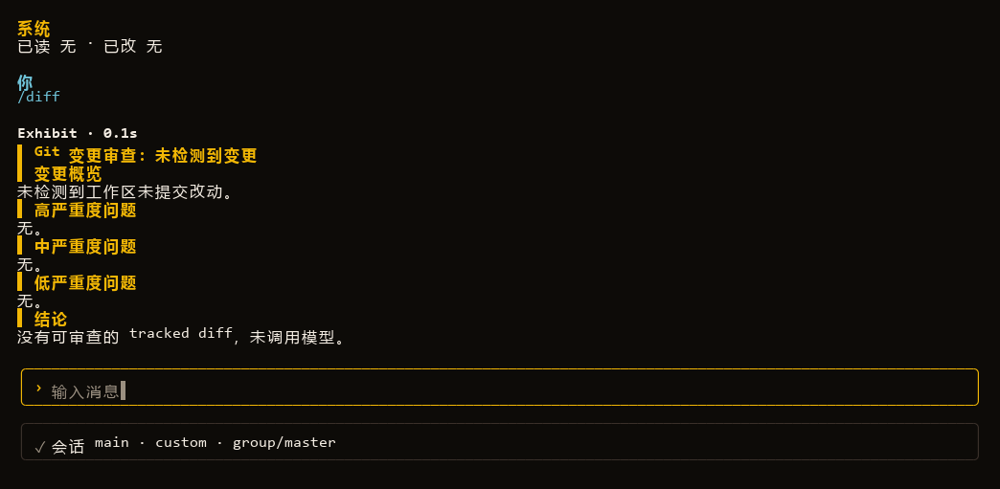

整仓/架构审查会给出更长的分级报告；当报告触到输出上限时，末尾会直接提示调大
`EXHIBIT_MAX_OUTPUT_TOKENS`：

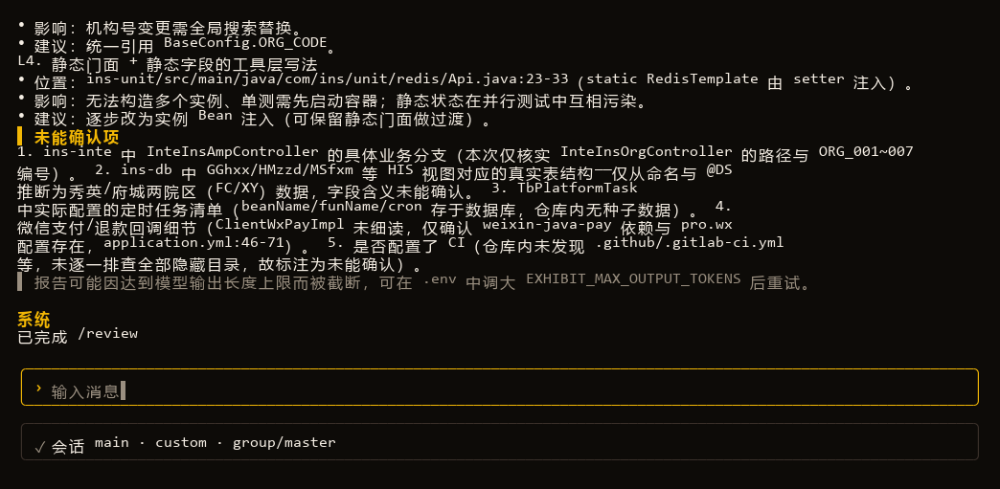

## 快速开始

```powershell
python -m venv .venv
.\.venv\Scripts\python.exe -m pip install -r requirements.txt
cd tui; npm install; cd ..
.\Exhibit.ps1
```

在任意项目中使用全局命令：

```powershell
cd D:\Code\Exhibit\tui
npm link

cd D:\path\to\another-project
exhibit
```

`exhibit` 默认审查当前目录，也支持指定项目或子目录：

```powershell
exhibit -Repo src
exhibit --repo-path D:\path\to\another-project
```

不带 TUI、直接跑一次任务（输出 JSON 事件流）：

```powershell
.\.venv\Scripts\python.exe -m agent.app --task arch_overview --repo-path examples/fixture-repo
```

## 登录与配置

启动 TUI 后输入 `/login`，可选择 OpenAI、DeepSeek、Qwen 或 OpenRouter。Key 以掩码输入，
经最小请求校验后保存到本地用户配置目录，不写入仓库。

选择「自定义 OpenAI 兼容端点」时，可连接 `127.0.0.1` 或 `::1` 上的本机服务，
例如 `http://127.0.0.1:3425/v1`。该例外只适用于自定义端点；内置供应商仍只接受
HTTPS 远程地址，其他 localhost 与私网地址也继续拒绝。

OpenRouter 默认使用 `openrouter/free` 免费路由，端点固定为
`https://openrouter.ai/api/v1`。若免费模型暂时限流或不可用，界面会显示明确错误，
不会留下空白回答。

```text
/login       配置模型供应商与 API Key
/provider    查看或切换模型供应商
/model       查看或切换模型
/logout      删除当前供应商凭据
```

输入 `/` 会直接显示命令和一行说明，不需要 `/help`。

环境变量适用于 CI、无头运行或显式覆盖：

- `EXHIBIT_BASE_URL`：远程 OpenAI 兼容 API，默认 `https://api.openai.com/v1`；
  内置供应商必须使用 HTTPS，且不能是本机或私网地址；显式选择 `EXHIBIT_PROVIDER=custom`
  时允许 `127.0.0.1` 或 `::1` 的 loopback 端点
- `EXHIBIT_API_KEY`：环境变量优先；未设置时无头模式会回退到 `/login` 保存的凭据
- `OPENROUTER_API_KEY`：仅使用 OpenRouter 无头模式时可替代 `EXHIBIT_API_KEY`；
  自动选择 OpenRouter 端点与 `openrouter/free`
- `EXHIBIT_MODEL`：默认 `gpt-5.4-mini`
- `EXHIBIT_PROVIDER`：保存了多个供应商时，指定使用哪一个（无头与聊天模式均生效）
- `EXHIBIT_MAX_ITERS`：ReAct 循环上限，默认 60
- `EXHIBIT_MAX_OUTPUT_TOKENS`：单次审查/报告的最大输出 token，默认 16000；报告被截断时调大
- `EXHIBIT_PROMPT_DIR`：自定义提示词目录，默认 `agent/prompts/`

提示词全部位于 `agent/prompts/*.md`。`chat.md`、`file_edit.md`、`plan.md` 用于聊天；
四类审查提示词由 `report_rules.md` 追加共享规则；`user_prompt.md` 支持
`{{repo_path}}` 与 `{{scope_line}}` 占位符。

## 文件修改与安全

- 默认工作区是当前仓库；任何路径不得越界。
- Agent 写入和替换只生成预览，用户在界面确认后才落盘。
- 禁止写入 `.git`、`.env`、`.venv`、`node_modules` 等敏感路径。
- 计划模式不注册写工具；审查任务始终只读。
- `/files` 区分已读取与已修改文件；`/undo` 可撤销最近一次 Agent 修改。
- 存在未确认写入时，`/quit` 和 `Ctrl+C` 会阻止退出。

## 开发

```powershell
# Python 测试
.\.venv\Scripts\python.exe -m pytest tests -q -p no:cacheprovider

# TUI 类型检查与测试
cd tui
node node_modules\typescript\bin\tsc -p tsconfig.json --noEmit
node node_modules\vitest\vitest.mjs run
```

## 目录

```
agent/            Python 智能体（AgentScope ReAct + 工具）
  app.py          stdio 入口，常驻聊天循环
  session.py      会话、计划模式、分叉与命令
  permissions.py  路径沙箱、预览、确认与撤销
  prompts/        聊天、计划、编辑与审查提示词
  prompt_loader.py  提示词加载与模板渲染
  protocol.py     JSON 行协议
  tools/          文件系统与 git 工具
tui/              React-Ink 终端界面
examples/         测试用样例仓库（内含未提交改动）
tests/            Python 单测
```

## 说明

- 报告默认中文，按「高 / 中 / 低」分级并给出 `文件:行号`。
- 审查结果直接显示在聊天流中，不再进入独立报告页。
- 真实模型调用需要有效 API Key；没有 Key 时不会伪造 AI 结果。
