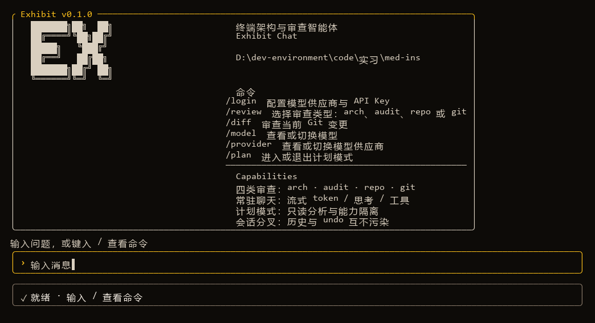
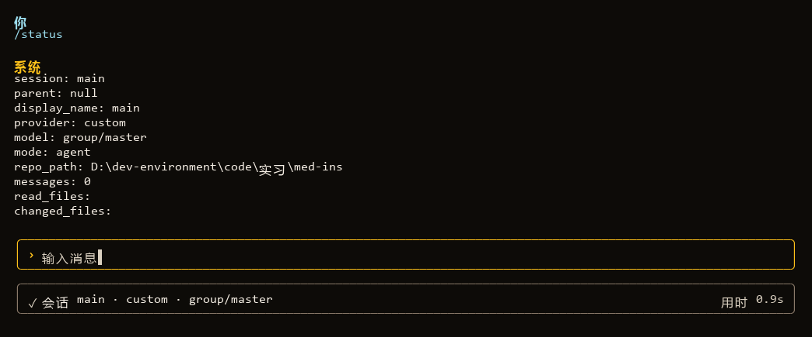
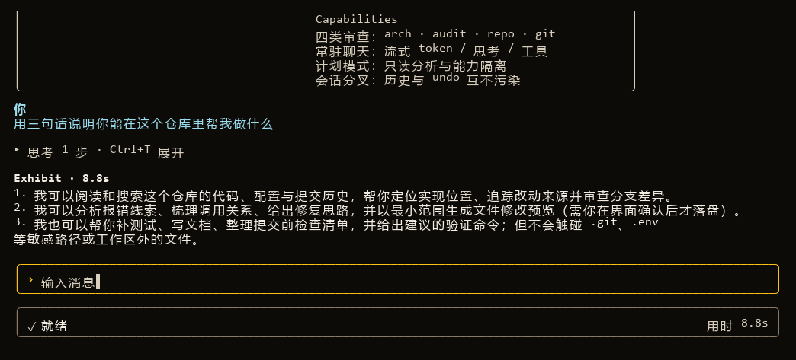
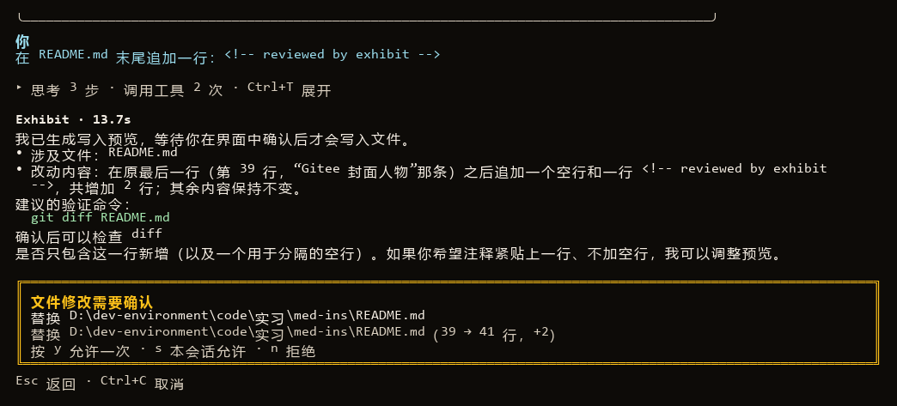
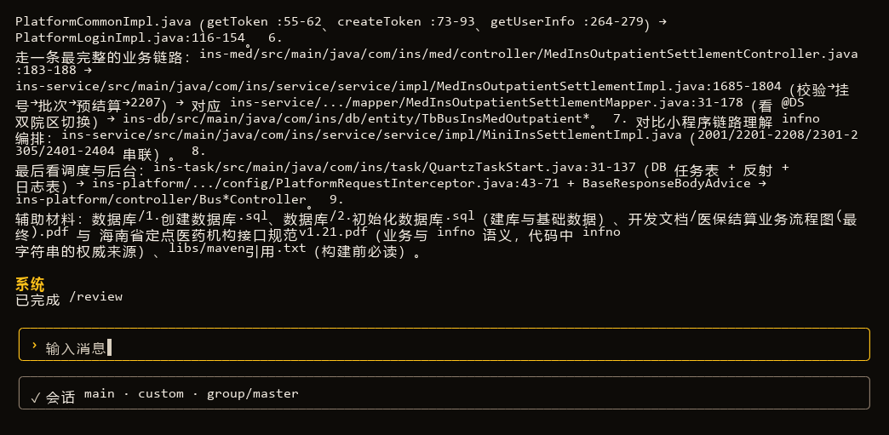
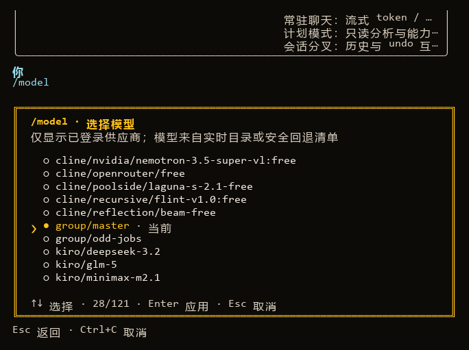

# Exhibit

Exhibit 是一个终端智能体：用 Python（AgentScope 2.x）做推理与真实工具调用，用
React-Ink 渲染终端界面，两者通过 stdio 上的 JSON 行协议通信。

## 能力

| 功能 | 说明 |
| --- | --- |
| 常驻聊天 | 多轮上下文、流式回复、普通问答与文件编写 |
| 计划模式 | `/plan` 只读分析；不注册写工具 |
| 会话分叉 | `/fork` 复制历史、模式和文件记录 |
| 四类审查 | `/init`、`/review arch\|audit\|repo\|git`、`/diff` |
| 增量复审 | 同一仓库重复审查只复核变更文件，缓存放在用户配置目录 |
| 自适应宽度 | 长路径、长模型 ID、长端点按终端列数截断（带「…」），窄终端不断框 |

## 界面一览

以下截图来自真实终端会话（Windows ConPTY，112 列），目标是 `med-ins` 这个
Spring Boot 医保结算仓库。



底部状态栏始终显示真正生效的 `会话 · 模式 · 供应商 · 模型`（`/status` 输出同样字段）：



**常驻聊天**：流式回复 + 折叠的运行轨迹（思考步数、工具次数，`Ctrl+T` 展开）



**写入确认**：所有修改先生成预览，按 `y` 允许一次、`s` 本会话允许、`n` 拒绝



**审查报告**：直接进入聊天流，中文分级，阅读路径按 `文件:行号` 落到具体实现



**窄终端**（72 列）：长模型 ID 不换行，页脚显示 `28/121`，边框与列对齐保持完整



## 快速开始

```powershell
python -m venv .venv
.\.venv\Scripts\python.exe -m pip install -r requirements.txt
cd tui; npm install; cd ..
.\Exhibit.ps1
```

在任意项目中使用全局命令：

```powershell
cd D:\Code\Exhibit\tui
npm link

cd D:\path\to\another-project
exhibit
```

`exhibit` 默认审查当前目录，也支持指定项目或子目录：

```powershell
exhibit -Repo src
exhibit --repo-path D:\path\to\another-project
```

不带 TUI、直接跑一次任务（输出 JSON 事件流）：

```powershell
.\.venv\Scripts\python.exe -m agent.app --task arch_overview --repo-path examples/fixture-repo
```

## 登录与配置

启动 TUI 后输入 `/login`，可选择 OpenAI、DeepSeek、Qwen 或 OpenRouter。Key 以掩码输入，
经最小请求校验后保存到本地用户配置目录，不写入仓库。

选择「自定义 OpenAI 兼容端点」时，可连接 `127.0.0.1` 或 `::1` 上的本机服务，
例如 `http://127.0.0.1:3425/v1`。该例外只适用于自定义端点；内置供应商仍只接受
HTTPS 远程地址，其他 localhost 与私网地址也继续拒绝。

OpenRouter 默认使用 `openrouter/free` 免费路由，端点固定为
`https://openrouter.ai/api/v1`。若免费模型暂时限流或不可用，界面会显示明确错误，
不会留下空白回答。

底部状态栏始终显示当前真正生效的 `会话 · 模式 · 供应商 · 模型`（例如
`会话 main · plan · custom · group/master`）；`/status` 输出同样的字段，所以不
用猜当前在调用哪个模型。

| 命令 | 说明 |
| --- | --- |
| `/login` `/logout` `/provider` `/model` | 登录、退出登录、切换供应商与模型 |
| `/status` | 会话、模式、供应商、模型、仓库与已读／已改文件 |
| `/init` | 生成架构总览，并把项目上下文记入会话 |
| `/review arch\|audit\|repo\|git` | 四类审查，逗号分隔可一次跑多个 |
| `/diff` | 审查当前 Git 变更（工作区／commit range／分支） |
| `/plan` | 进入或退出只读计划模式 |
| `/fork` | 从当前对话创建分支会话 |
| `/compact` `/clear` | 压缩或清空对话上下文 |
| `/permissions` `/files` `/undo` | 写入策略、已读／已改文件、撤销最近一次修改 |
| `/quit` | 退出（存在未确认写入时会阻止） |

输入 `/` 会直接显示命令和一行说明，不需要 `/help`。

环境变量适用于 CI、无头运行或显式覆盖：

- `EXHIBIT_BASE_URL`：远程 OpenAI 兼容 API，默认 `https://api.openai.com/v1`；
  内置供应商必须使用 HTTPS，且不能是本机或私网地址；显式选择 `EXHIBIT_PROVIDER=custom`
  时允许 `127.0.0.1` 或 `::1` 的 loopback 端点
- `EXHIBIT_API_KEY`：环境变量优先；未设置时无头模式会回退到 `/login` 保存的凭据
- `OPENROUTER_API_KEY`：仅使用 OpenRouter 无头模式时可替代 `EXHIBIT_API_KEY`；
  自动选择 OpenRouter 端点与 `openrouter/free`
- `EXHIBIT_MODEL`：默认 `gpt-5.4-mini`
- `EXHIBIT_PROVIDER`：保存了多个供应商时，指定使用哪一个（无头与聊天模式均生效）
- `EXHIBIT_MAX_ITERS`：ReAct 循环上限，默认 40（也决定一次运行的成本上限；报告规则会要求模型预留轮次写报告）
- `EXHIBIT_MAX_OUTPUT_TOKENS`：单次审查/报告的最大输出 token，默认 16000；模型提前结束
  时报告末尾会附提示，调大后重试即可
- `EXHIBIT_TIMEOUT`：单次模型请求的超时秒数，默认 600，聊天与审查模式同样生效
- `EXHIBIT_PROMPT_DIR`：自定义提示词目录，默认 `agent/prompts/`
- `EXHIBIT_EXPLORE_MODEL`：开启两阶段运行。先用这个（便宜的）模型做只读取证，
  再由主模型仅依据证据清单写报告；探索阶段那几十万字符的上下文不会进入主模型的
  计费。示例：`EXHIBIT_EXPLORE_MODEL=deepseek-flash`
- `EXHIBIT_CONFIG_DIR`：凭据与复审缓存目录，默认 `%APPDATA%\Exhibit`

提示词全部位于 `agent/prompts/*.md`。`chat.md`、`file_edit.md`、`plan.md` 用于聊天；
四类审查提示词由 `report_rules.md` 追加共享规则；`user_prompt.md` 支持
`{{repo_path}}`、`{{scope_line}}` 与 `{{untracked_hint}}` 占位符，漏填会直接报错。

## 复审与成本

- **增量复审**：同一仓库同一任务的报告缓存在用户配置目录，并为每个文件记下
  `mtime + 大小`。下次运行时若变更占比不高，就把上次报告和变更清单作为前置上下文，
  让模型只复核改动过的文件与旧报告里标注「未能确认」的部分；变更超过一半则丢弃旧结论、
  按全新审查处理。适用于 `arch_overview`、`arch_audit`、`review_repo`；`review_git`
  每次面对的都是新 diff，因此不复用旧报告。缓存不写进被审仓库。
- **两阶段取证**：设置 `EXHIBIT_EXPLORE_MODEL` 后，先由便宜模型只读收集证据，
  主模型只依据截到 12k 字符的证据清单写报告。
- **迭代预算**：`EXHIBIT_MAX_ITERS` 同时是一次运行的成本上限。
- **上下文压缩**：单条工具结果最多 1500 字符进入上下文，占用达到窗口 25% 时自动压缩。

## 文件修改与安全

- 默认工作区是当前仓库；任何路径不得越界。
- Agent 写入和替换只生成预览，用户在界面确认后才落盘。
- 禁止写入 `.git`、`.env`、`.venv`、`node_modules` 等敏感路径。
- 计划模式不注册写工具；审查任务始终只读。
- `/files` 区分已读取与已修改文件；`/undo` 可撤销最近一次 Agent 修改。
- 存在未确认写入时，`/quit` 和 `Ctrl+C` 会阻止退出。
- git 工具固定在被审仓库根运行；越界 `repo_path` 直接报错，不会误操作另一个仓库。
- `git_diff` 只接受 `--cached`、`--staged`、`--stat` 等只读参数，`--output=` 之类会被拒绝。
- `/undo` 发现文件内容已被外部改动时拒绝撤销。
- 审查过程只读：结束后工作区的 `git status` 与开始前一致。

## 开发

```powershell
# Python 测试
.\.venv\Scripts\python.exe -m pytest tests -q -p no:cacheprovider

# TUI 类型检查与测试
cd tui
node node_modules\typescript\bin\tsc -p tsconfig.json --noEmit
node node_modules\vitest\vitest.mjs run
```

## 目录

```
agent/            Python 智能体（AgentScope ReAct + 工具）
  app.py          入口：无头任务与常驻聊天循环
  agents.py       构建 ReAct agent、工具注册与上下文配置
  config.py       环境变量与已保存凭据 → Config
  session.py      会话、计划模式、分叉与命令
  chat.py         斜杠命令实现
  permissions.py  路径沙箱、预览、确认与撤销
  review_cache.py 增量复审缓存（上次报告 + 文件快照）
  credentials.py  供应商凭据的保存与读取
  providers.py    内置供应商与端点校验
  models.py       模型目录发现
  prompts/        聊天、计划、编辑与审查提示词
  prompt_loader.py  提示词加载与模板渲染
  protocol.py     JSON 行协议
  tools/fs.py     文件系统工具（列表、读取、搜索）
  tools/git.py    git 工具（状态、diff、日志、分支对比）
tui/              React-Ink 终端界面
examples/         测试用样例仓库（内含未提交改动）
tests/            Python 单测
```

## 说明

- 报告默认中文，按「高 / 中 / 低」分级并给出 `文件:行号`。
- 审查结果直接显示在聊天流中，不再进入独立报告页。
- 真实模型调用需要有效 API Key；没有 Key 时不会伪造 AI 结果。
